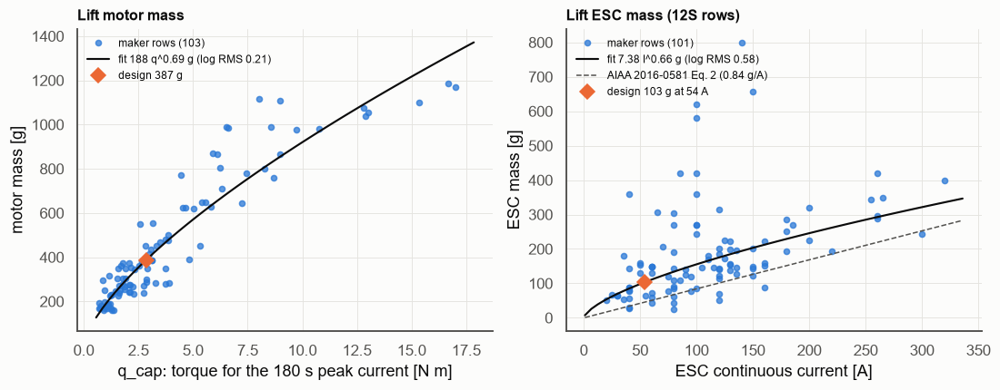

# Quadplane modelling report: how AeroPlan sizes the Rosella

Status: 2026-11-02. AeroSandbox model files in `aeroplan/aerosandbox/` (ADR 0022, ADR 0024, ADR 0028), the Rosella model
file `aeroplan/aerosandbox/settings/rosella.json`, the notebook `aeroplan/aerosandbox/notebooks/rosella_sizing.ipynb`.

This report tells you what each function of the quadplane model does, which method it uses, where its data comes
from, and where the method stops being valid. Read it before you change the model or trust a number from it. The
links go to the code. The numbers in section 10 come from the notebook run of 2026-11-02.

## 1. The model in one page

The Rosella is the Currawong airframe (wing, tail, tail boom, nose propeller) with a new fuselage and two lift booms.
Each boom carries a lift rotor at each end (layout H4) or a coaxial pair at each end (layout H8). The model finds the
design that needs the least mission energy and meets every limit.

| Part of the aircraft | Method | Data | Section |
|---|---|---|---|
| Wing, tail, tail boom | Copied from the Currawong source tree, no change | `aircraft/currawong` (ADH geometry) | 3 |
| Neutral point | Vortex lattice (VLM 16x12) of wing, htail and fin, plus the AeroBuildup body term | Currawong geometry, new fuselage | 3 |
| Cruise drag polar | AeroBuildup with NeuralFoil sections, CD = CD0 + k CL^2 | Currawong geometry, new fuselage | 3 |
| Lift rotors | Proptimiser blade element momentum theory (BEMT), at four fidelities | A Jung 2021 blade fitted to the MAD FLUXER 22x6.6 | 4 |
| Cruise propeller | Proptimiser BEMT of the Currawong nose propeller | The Currawong propeller design | 4 |
| Motor, ESC | Log-linear fits on maker data | `data/motor_survey.csv` (103 fit rows), `data/esc_survey.csv` (101 rows at 12S) | 5, 6 |
| Battery | AIAA 2016-0581 Eq. 4, calibrated to a known pack; OCV curve of a LiPo cell | NXE 6S 4500 pack; Galeotti 2023 cells | 5, 6 |
| Masses kept from the Currawong | Weighed items of the Currawong specification sheet | `Currawong Master Specification Sheet.xlsx` through the SpecSheet spoke | 6 |
| Booms | Thin carbon tube: stress, buckling, tip slope, first bending mode | Tube and material params | 7 |
| Mission | Eight segments, pack discharge by the midpoint rule | Redback flight 00000171, 10 laps | 8 |
| Optimiser | CasADi Opti and IPOPT, elastic feasibility phase, fidelity ladder L0 to L4 | Solver settings | 2 |

The frame of the model is x aft, y right, z up (the AeroSandbox frame), origin at the wing root leading edge. The
source tree is FRD (ADR 0029). `AirframeModel` flips every position that it reads from the tree, and the spoke flips the
result back when it writes the tree.

## 2. The model chain and the fidelity ladder

| Function | Job |
|---|---|
| [`Param`, `Component`](../../../aeroplan/aerosandbox/component.py#L63) | A param is a value with units, source, bounds and a `free` flag. A component (`Rotor`, `Motor`, `Battery` and others) holds params. A free param is a design variable. |
| [`QuadplaneModel`](../../../aeroplan/aerosandbox/model.py#L128) | The components of one aircraft, its layout (H4 or H8) and its equations. `save` writes the model file (JSON). |
| [`LEVELS`](../../../aeroplan/aerosandbox/component.py#L430) | Five fidelity levels. Each level sets the rotor model of the lift and cruise rotors and the constraint groups that are on. |
| [`Problem`](../../../aeroplan/aerosandbox/optimise.py#L54) | One CasADi `Opti` problem of a model at one level: `design` (a design variable), `state` (another variable), `limit` (a constraint that the report keeps), `build`, `solve` (IPOPT, exact Hessian), `report`. |
| [`solve_level`](../../../aeroplan/aerosandbox/optimise.py#L315) | One level in two phases. The elastic phase adds a slack to each limit and minimises the slacks. When the largest slack is at most 1e-4, the optimality phase starts from that point. |
| [`ladder`](../../../aeroplan/aerosandbox/optimise.py#L391) | Runs L0 to L4. Each level starts from the result of the level below. L0 and L1 use five starts (one base start and four random starts with a fixed seed). It writes `work/aerosandbox/rosella/notebook_ladder/<case>/L<k>.json`. |
| [`evaluate`](../../../aeroplan/aerosandbox/optimise.py#L491) | The design as it is: every param fixed except the battery x (it closes the CG). Use it to check a bought part. |

| Level | Lift rotor | Cruise rotor | Constraint groups |
|---|---|---|---|
| L0 | momentum (constant FM and CT0) | momentum (constant efficiency and J) | mass, CG, energy, thrust to weight |
| L1 | CT/CP table | CT/CP table | adds the electric chain (motor, ESC, duty, current, C-rate) |
| L2 | CT/CP table | CT/CP table | adds structure, stiffness, clearances and control |
| L3 | full BEMT for the take-off hover, table elsewhere | table | all |
| L4 | full BEMT in every state | full BEMT | all |

The objective is the mission energy at the pack terminals (Wh). The result of the ladder is the L4 result.

## 3. The airframe

### 3.1 The base airframe from the source tree

| Function | Job |
|---|---|
| [`base_document`](../../../aeroplan/aerosandbox/component.py#L53) | Reads the source tree of the base aircraft (`airframe.base = "currawong"`). This is the only read of the source tree in the model files. |
| [`AirframeModel.__init__`](../../../aeroplan/aerosandbox/component.py#L1004) | Reads S, b and c (`adh_doc.reference`, node 1.2 `parameters.reference_data`), the point masses (flipped from FRD), the wing, htail and fin (`surface_spec`), the tail boom frames, the cruise motor and propeller, and the fuselage mass per shell area. Then it finds the neutral point, the CG (NP minus the static margin target times c) and the polar. |
| [`surface_spec`](../../../aeroplan/aerosandbox/component.py#L939) | One lifting surface of the tree as a section list (ADH `geometry.lifting_surface`, with the control-surface stations as extra sections). |
| [`build_airplane`](../../../aeroplan/aerosandbox/component.py#L964) | The AeroSandbox `Airplane`: wings with their foils, the fuselages from their frames, and the propeller disc. |
| [`Fuselage.frames`, `Fuselage.area_m2`](../../../aeroplan/aerosandbox/component.py#L361) | The new fuselage: superellipse sections from the nose (behind the nose hub) to the pod tail end. The nose grows to the full section at 25 % of the length, holds it to 65 %, and tapers to the tail boom joint. The wetted area sets the fuselage mass. |

### 3.2 The neutral point: VLM plus a body term

[`AirframeModel._neutral_point`](../../../aeroplan/aerosandbox/component.py#L1088) runs the AeroSandbox
`VortexLatticeMethod` (16 spanwise and 12 chordwise panels, trailing vortices fixed to the body) on the wing, the htail
and the fin at alpha 0 and 4 deg, 17 m/s, sea level. It adds the CL and Cm of an AeroBuildup run on the fuselage and
the tail boom alone. The neutral point is

    x_NP = x_ref - c dCm/dCL

The VLM has no body. The Currawong methods report (section 1) shows why the VLM is used and not AeroBuildup or the
lifting line: NeuralFoil gives the NACA 0012 tail a 2D slope of about 8 per rad at Re 2e5, so those two methods give too
much tail and too much static margin.

The CG follows from the neutral point: `x_cg = x_NP - static_margin_target * c`. The battery x is a design variable,
and an equality constraint holds the mass CG at this x.

### 3.3 The cruise polar

[`AirframeModel._polar`](../../../aeroplan/aerosandbox/component.py#L1107) runs AeroBuildup (NeuralFoil sections) on
the full airframe with the new fuselage from -2 to 12 deg at 17 m/s and 53 m. It fits CD = CD0 + k CL^2 over CL 0.2 to
0.9 and takes CL max at 12 deg. The cruise condition adds the drag areas of the lift booms (skin friction times a form
factor), the motor nacelles and the stopped lift propellers (`cruise_aero` params).

### 3.4 The flow5 cross-check of 2026-11-02

The Rosella has no flow5 model. The Currawong does, and its wing and tail are the Rosella wing and tail. The flow5
sweep `currawong_2026-10-30` put the Currawong neutral point at 0.270 m aft of the wing leading edge. The VLM plus the
body term puts it at 0.171 m. A controlled flow5 study (T7 and T1 runs at one CG, `work/flow5/currawong/exp/2026-11/`)
found the cause:

| Model | Body | NP x (m aft of the wing LE) |
|---|---|---|
| flow5 | none | 0.199 |
| flow5 | forebody, closed 0.10 m behind the wing LE | 0.191 |
| flow5 | body closed at the wing root trailing edge | 0.243 |
| flow5 | full CREO body (41 frames, to 0.56 m) | 0.270 |
| flow5, thick surfaces | full CREO body | 0.334 |
| AeroSandbox VLM | none | 0.182 |
| AeroSandbox VLM + AeroBuildup body | full CREO body | 0.171 |

- Without a body, flow5 and the VLM differ by 17 mm (5 % of c).
- A closed body ahead of the wing moves the flow5 NP forward by 8 mm. The body term of AeroSandbox moves it forward by
  12 mm. Both agree with slender body theory (the Munk moment is destabilising).
- The flow5 NP moves aft as the closed body covers more of the wing root. flow5 makes the same body of about 200
  panels for any frame count and any mesh setting in the plane file, and the thin wing root lies inside the body
  without a join. The aft shift of the full body is a fault of this flow5 model, not a property of the aircraft.

The sizing keeps the VLM plus the body term. Do not use a flow5 static margin of the Currawong with the full body until
the body mesh and the wing-body join are fixed in flow5.

## 4. The rotors: Proptimiser BEMT

Proptimiser is a blade element momentum (BEMT) package from its own repository. `aeroplan setup AeroSandbox` installs it
in the AeroSandbox Python. Its sections take their lift and drag from NeuralFoil. The model uses axial inflow only (`n_psi = 1`).

| Function | Job |
|---|---|
| [`Rotor`](../../../aeroplan/aerosandbox/component.py#L284) | The lift rotor: a Proptimiser design scaled in radius (`scale` is free), the cant angle (free), the tip Mach limit, and the table and momentum sample points. |
| [`proptimiser_home`](../../../aeroplan/aerosandbox/component.py#L621) | Copies the design file and the state file into `work/aerosandbox/rosella/proptimiser`. A copy with another sha256 is replaced. |
| [`prop_model`](../../../aeroplan/aerosandbox/component.py#L653) | The CasADi Proptimiser model of one design (`PropellerModel.from_propeller`). |
| [`omega_guess`](../../../aeroplan/aerosandbox/component.py#L664) | A start value of the shaft speed for a thrust: two numeric BEMT solves at 400 and 700 rad/s fix a line of T against omega^2, a third solve refines it. |
| [`RotorModel.momentum`](../../../aeroplan/aerosandbox/component.py#L821) | Level L0. One BEMT solve gives the figure of merit FM and the hover CT0 of the base blade. Then P = T (V/2 + sqrt((V/2)^2 + T / (2 rho A))) / FM. The cruise rotor gets one efficiency and one advance ratio at 17 m/s. |
| [`LiftTable`](../../../aeroplan/aerosandbox/component.py#L703) | Levels L1 to L3. Numeric BEMT samples over shaft speed, axial speed and scale (cached in `work/aerosandbox/rosella/tables`). A polynomial of degree 3 in the tip Mach number and J, plus terms in ln(scale), fits CT and CP. |
| [`CruiseTable`](../../../aeroplan/aerosandbox/component.py#L751) | The same for the cruise propeller: CT and CP against J (up to `table_fit_J_max`) and the tip Mach number. |
| [`RotorModel.add`](../../../aeroplan/aerosandbox/component.py#L838) | Adds one rotor at one flight state to the problem. Table: the shaft speed is a variable and T from the table must equal the needed thrust. BEMT: Proptimiser adds its inflow variables and equations (`add_to`), with a warm start. |
| [`rotor_model`](../../../aeroplan/aerosandbox/component.py#L881) | Picks momentum, table or BEMT from the level and the state. |

The blade. The lift blade `MAD_FLUXER_22x6_6_jung` is the T-motor blade shape of Jung et al. 2021 (chord and twist
read from their figures, `data/jung2021_blades.csv`) fitted to the maker thrust table of the MAD FLUXER 22x6.6 (R0 =
0.2794 m). The sizing scales its radius. [`scaled_blade`](../../../aeroplan/aerosandbox/component.py#L1249) and
[`jung_compare`](../../../aeroplan/aerosandbox/component.py#L1213) check the chord and twist of the scaled blade
against the Jung blades (notebook section 8).

The dataset. The spoke writes the BEMT samples of the scaled blade to
`aircraft/rosella/datasets/propulsion.rosella_lift_bemt.json` (omega, axial speed, scale, J, CT, CP, T, Q).

Limits of the rotor model:
- Axial inflow only. In-plane inflow (edgewise flight, transition) is not in the model.
- The stopped lift rotors in cruise are a drag area, not a rotor.
- A coaxial pair (H8) uses one power factor `k_int` for the interference.
- The BEMT has no tip loss calibration against a test of this blade. The maker table of the FLUXER 22x6.6 is the only
  check.

## 5. The electric chain

| Function | Equation | Source |
|---|---|---|
| [`QuadplaneModel._lift_rotor`](../../../aeroplan/aerosandbox/model.py#L299) | I = Q Kv + I0, Vm = omega / Kv + Rm I, Pe = Vm I + (Re + Rw) I^2 | First-order DC motor (Drela), AIAA 2016-0581 |
| [`electric_chain`](../../../aeroplan/aerosandbox/component.py#L1159) | The Propalyser chain for the cruise motor: I = I0 + (Q + Q0) Kv, V = omega / (kappa Kv) + R_tot I | Propalyser `estimate/chain.py` |
| [`Battery.mass_kg_of`](../../../aeroplan/aerosandbox/component.py#L337) | m = k (p1 S + p2) C, k from the NXE 6S 4500 pack (0.631 kg) | AIAA 2016-0581 Eq. 4 |
| [`OCVModel`](../../../aeroplan/aerosandbox/component.py#L554) | Cell OCV against SOC: polynomial of degree 6 on `data/ocv_lipo.csv`, and its integral F | Galeotti et al. 2023 (stand-in cell) |
| [`pack_current`](../../../aeroplan/aerosandbox/mission.py#L141) | P = (V_oc - R_b I) I, the low root | Xing et al. 2014, Eq. 5 (as in Aerolink) |

The pack resistance is R_b = S r_cell 4.5 / C (the cell resistance of a 4.5 Ah cell, scaled with the capacity). The
wire resistance comes from the copper area and the run length from the battery to each hub (`Cables`). The MAX state
(full thrust at the lowest SOC of the mission) sets the limits on the motor torque, the motor current, the ESC duty and
the C-rate.

## 6. Mass

### 6.1 The mass list

[`QuadplaneModel.design`](../../../aeroplan/aerosandbox/model.py#L161) builds a list of point masses (name, mass, x, y,
z and the own inertia of the long parts). The sum is the mass, the first moment sets the CG constraint, and the parallel
axis rule gives Ixx, Iyy and Izz about the CG.

| Item | Source |
|---|---|
| wing, tail, tail boom, flight avionics | Kept from the Currawong. The SpecSheet spoke wrote them from the weighed rows of `aeroplan/specsheet/sheets/currawong/Currawong Master Specification Sheet.xlsx` (ADR 0012). |
| cruise motor, ESC, propeller, rest | Kept from the Currawong, moved with the nose hub. |
| fuselage | Shell area of the new fuselage times the Currawong mass per area (FUSELAGE-REST over the area of the same body rule at the Currawong length). |
| project avionics, cargo, landing gear, boom clamp | Component params (stand-ins, `placeholder: true`). |
| lift motor | `MotorModel` fit (6.2). |
| lift ESC | `ESCModel` fit at 1.2 times the peak motor current (6.2), or the mass of a bought ESC. |
| lift propeller | Carbon fit m = a D^2 + b D (AIAA 2016-0581 Eq. 5), or the mass of a bought propeller. |
| battery | Eq. 4 (section 5). |
| booms | Tube density times section area times length (`Tube.section`). |
| cables | Copper area from the peak current and the current density, times the run lengths, times an insulation factor. |

The spoke writes the same list to node 1.2 (`point_masses`) and rolls it up again with
[`mass_model.rollup`](../../../aeroplan/mass_model.py#L45) into `mass_properties`. The two roll-ups must agree.

### 6.2 The motor and ESC fits

| Function | Fit (log-linear least squares) | Rows |
|---|---|---|
| [`MotorModel`](../../../aeroplan/aerosandbox/component.py#L454) mass | m = exp(a0) q_cap^a1, q_cap = (Imax - I0) / Kv (the torque the motor holds at its peak current) | 103 rows with kv, mass, Rm, I0 and Imax, kv 60-450 rpm/V, 150-1600 g |
| `MotorModel` Rm | Rm = exp(b0) kv^b1 m^b2 | the same |
| `MotorModel` I0 | I0 = exp(c0) kv^c1 m^c2 | the same |
| [`ESCModel`](../../../aeroplan/aerosandbox/component.py#L522) | m = exp(e0) I^e1, I the continuous current | 101 rows rated for 12S |

The mass fit has no kv term. With a kv term the solver moved kv to make the motor light. One frame with other windings
has the same mass (T-Motor MN705-S KV125 and KV260 are both 450 g).

| Fit | Rows (2026-10-21 / 2026-11-02) | Exponent | Log RMS |
|---|---|---|---|
| Motor mass | 38 / 103 | 0.627 / 0.690 | 0.209 / 0.212 |
| Motor Rm | 38 / 103 | kv -1.317 / -1.201, m -1.308 / -1.440 | 0.248 / 0.342 |
| Motor I0 | 38 / 103 | kv 0.628 / 0.581, m 0.690 / 1.019 | 0.319 / 0.423 |
| ESC mass (12S) | 9 / 101 | 0.917 / 0.662 | 0.354 / 0.576 |

The motor mass fit hardly changed. The Rm and I0 fits have more scatter, because the makers test I0 at 10 V to 24 V
and do not say how they measure Rm. The ESC fit has the most scatter, because the makers give the mass with wires,
without wires, or do not say. `data/vendor_survey_SOURCE.md` gives the rules, the counts and the known mixed
definitions.

## 7. The booms

| Function | Equation |
|---|---|
| [`Tube.section`](../../../aeroplan/aerosandbox/component.py#L236) | Area and second moment of a thin tube |
| [`Tube.buckling_stress`](../../../aeroplan/aerosandbox/component.py#L242) | Local buckling of a thin cylinder, times a knockdown factor |
| [`Tube.f1_hz`](../../../aeroplan/aerosandbox/component.py#L247), [`Tube.modes_hz`](../../../aeroplan/aerosandbox/component.py#L276) | First (and second) bending mode of a cantilever with a tip mass and a tip rotary inertia |
| `build`, structure block ([model.py](../../../aeroplan/aerosandbox/model.py#L418)) | Each boom end is a cantilever of length a from the clamp. Two load cases: the MAX thrust, and 3 g on the tip mass. Von Mises stress (bending and the torque of the motor), buckling, tip slope, r/t |

The first bending mode must stay out of the band of the hover 1P (shaft frequency) plus or minus the margin, at the
take-off and the landing mass. With `resonance_side = below` the mode is under the band, so every speed from hover to
full throttle is above it. The model assumes a rigid clamp and a rigid wing, so the real first mode is lower.

## 8. The mission and the energy

| Function | Job |
|---|---|
| [`Mission.conditions`](../../../aeroplan/aerosandbox/mission.py#L68) | Six steady states: H_TO (hover, take-off mass), C_TO (vertical climb), H_L (hover, cargo gone), MAX (thrust to weight 2.3), F_LAP and F_MAP (cruise on the nose propeller, F_MAP with the survey turns) |
| [`QuadplaneModel._lift_condition`](../../../aeroplan/aerosandbox/model.py#L314) | Hover thrust of the front and the rear rotor from the moment balance about the CG, divided by cos(cant) |
| [`QuadplaneModel._cruise_condition`](../../../aeroplan/aerosandbox/model.py#L327) | Drag = q S (CD0 + k CL^2) + q (boom, nacelle and stopped-prop drag areas). The nose propeller gives T = D. Duty, current and tip Mach limits |
| [`Mission.segments`](../../../aeroplan/aerosandbox/mission.py#L85) | Eight segments: VTOL climb, transitions, fixed-wing climb, transit and laps and return, survey, deployment hover, landing, reserve hover |
| [`Mission.discharge`](../../../aeroplan/aerosandbox/mission.py#L110) | Takes the pack from SOC 1 through the segments in flight order, four midpoint steps per segment. The energy of a segment is S C (F(SOC start) - F(SOC end)), so it includes the R_b I^2 loss. The limit: the energy is at most the usable energy to the lowest SOC |

## 9. Control, clearances and the bay

`build` ([model.py](../../../aeroplan/aerosandbox/model.py#L458)) adds:
- Clearances in plan view: rotor tip to fuselage, front disc to wing LE, rear disc to wing TE, rear disc to htail,
  disc to disc.
- Control authority in hover: roll and pitch acceleration from the thrust change between idle and hover, against a
  Froude-scaled attitude bandwidth. Yaw acceleration from the drag torque change and the cant force.
- The battery bay: the pack volume (from the nominal energy and Wh per litre) must fit 40 % of the bay box.

## 10. Results with the 2026-11-02 data

The notebook ran the ladder L0 to L4 again with the 2026-11-02 surveys. Every level converged. The airframe numbers
do not change: the copied Currawong items are the same (section 6.1), and the Rosella has no flow5 input (section 3.4).

| Quantity | Before (38 motor, 9 ESC rows) | After (103 motor, 101 ESC rows) |
|---|---|---|
| Mass (kg) | 17.458 | 17.418 |
| Mission energy (Wh) | 427.4 | 426.2 |
| Lift motor, each (g) | 370 | 387 |
| Lift ESC, each (g) | 127 | 103 |
| Battery (kg), capacity (Ah) | 3.236, 11.54 | 3.227, 11.51 |
| Motor kV (rpm/V), peak torque (N m) | 145.7, 2.862 | 145.8, 2.850 |
| Motor Rm (mOhm), I0 (A) | 63.8, 1.161 | 64.6, 1.137 |
| Rotor diameter (mm) | 660 | 660 |
| Neutral point, CG (m aft of the wing LE) | 0.172, 0.139 | 0.172, 0.139 |
| Cruise polar CD0, k, CL max | 0.0138, 0.0398, 1.457 | the same |

The active limits stay the same: the front motor torque and current, the rear ESC duty, the energy, the fuselage and
wing TE clearances, and the yaw control. The design moves by less than 1 % in each variable. The ESC fit gives a
lighter ESC (the new rows include light airplane ESCs), and the motor fit gives a slightly heavier motor.

## 11. What the spoke writes to the source tree

[`_ingest_quadplane`](../../../aeroplan/aerosandbox/spoke.py#L962) runs in `python -m aeroplan build rosella` (the build
runs the ingest of each spoke). It reads the model file and writes:
- Copies of the Currawong nodes 1.2.2.3 (wing, ailerons) and 1.2.2.4 (empennage, stabilizer, tail boom).
- The new fuselage 1.2.2.2 and the two lift booms (`muas.tube`).
- 1.2.3.9: the cruise propeller and the lift rotors. 1.2.3: the lift propulsion system and its BEMT dataset.
- 1.2: the point masses, the mass properties (`mass_model.rollup`), the reference (MRP = the sized CG), the initial
  conditions and the `sizing` record.
- Every estimate carries `placeholder: true` and names its source.

## 12. Known limits

- The neutral point has no flow5 or wind tunnel check for the Rosella body. The flow5 check in 3.4 uses the Currawong.
- The rotors see axial inflow only. Transition and edgewise flight are not modelled.
- The VLM and AeroBuildup have no lift booms and no rotor wake on the wing.
- The motor and ESC fits mix maker test methods (section 6.2). A bought part replaces the fit (`mass_kg`, `rm_ohm`,
  `i0_A` of the motor, `mass_kg` of the ESC).
- The OCV curve is of a small BAK cell, not the pack cell. The cell resistance is a stand-in.
- The boom mode assumes a rigid clamp and a rigid wing.

## 13. References

- Bershadsky, D., Haviland, S., Johnson, E. N., "Electric Multirotor UAV Propulsion System Sizing for Performance
  Prediction and Design Optimization", AIAA 2016-0581. Eq. 4 (battery), Eq. 5 (propeller), the motor chain.
- Jung et al., Unmanned Systems 9(4) 321-332, 2021, doi 10.1142/S2301385021500163 (CC BY 4.0). Blade chord and twist.
- Galeotti, M. et al., "LiPo batteries dataset", Data in Brief 50, 109561, 2023, doi 10.1016/j.dib.2023.109561. OCV.
- Xing, Y. et al., 2014, Eq. 5: the pack circuit (as in Aerolink `xing_soc.py`).
- Munk, M. M., "The aerodynamic forces on airship hulls", NACA Report 184, 1924. The destabilising body moment.
- Sharpe, P. D., AeroSandbox (VortexLatticeMethod, AeroBuildup, NeuralFoil).
- The Currawong AeroSandbox methods report: [../currawong_aero_methods/README.md](../currawong_aero_methods/README.md).
