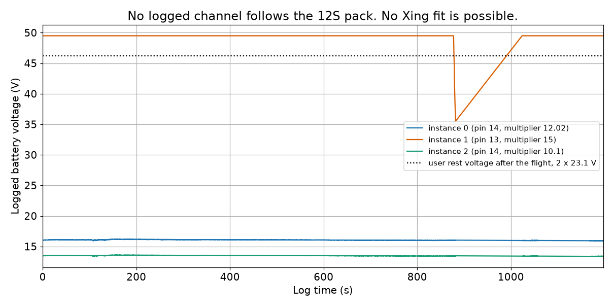
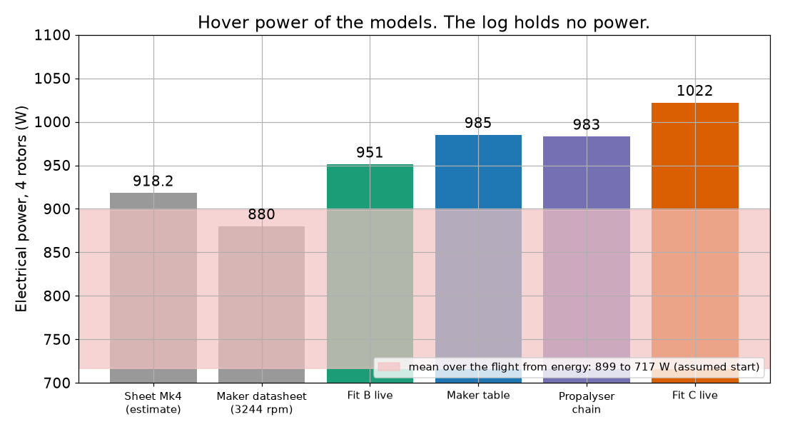
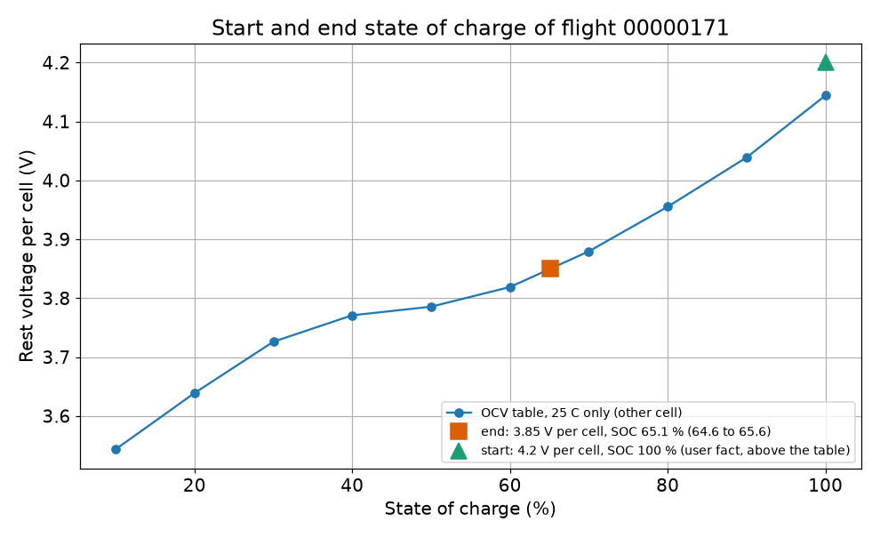
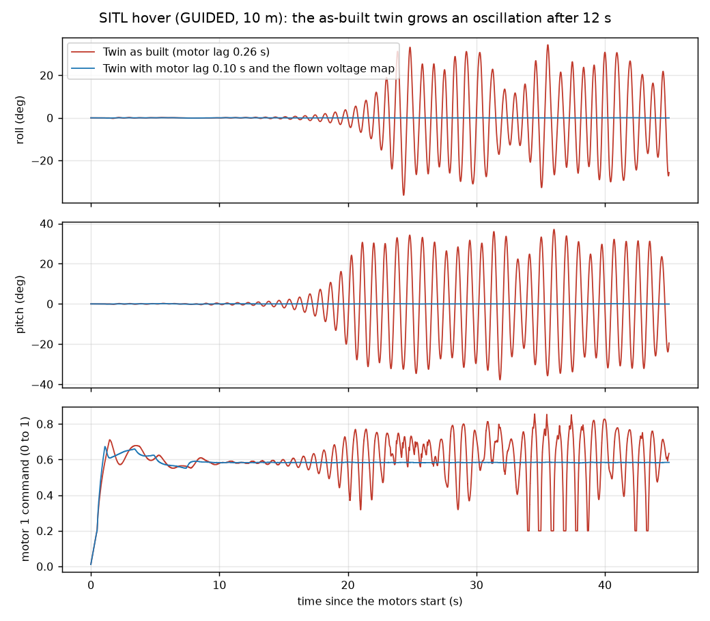
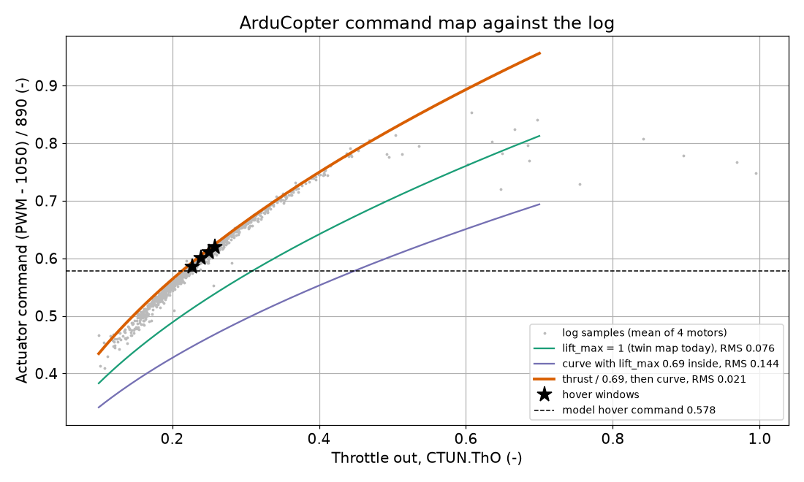
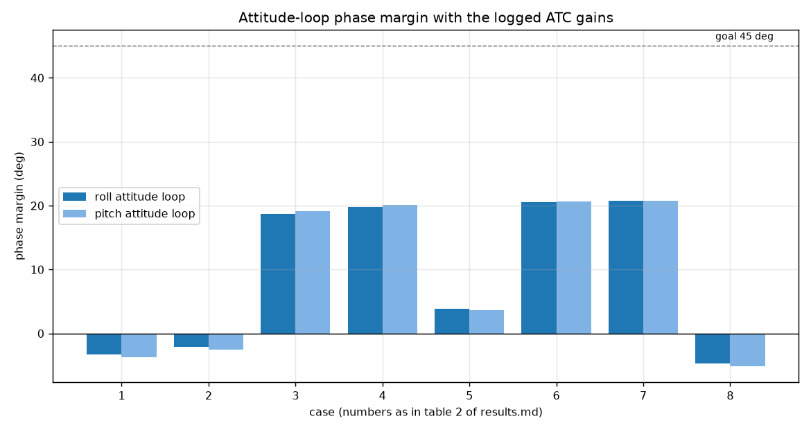
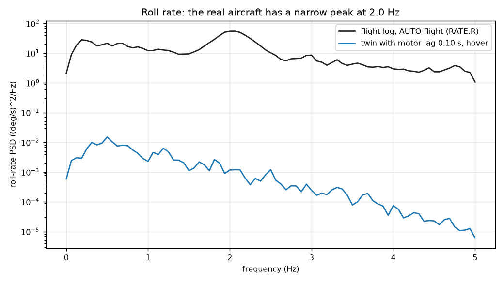
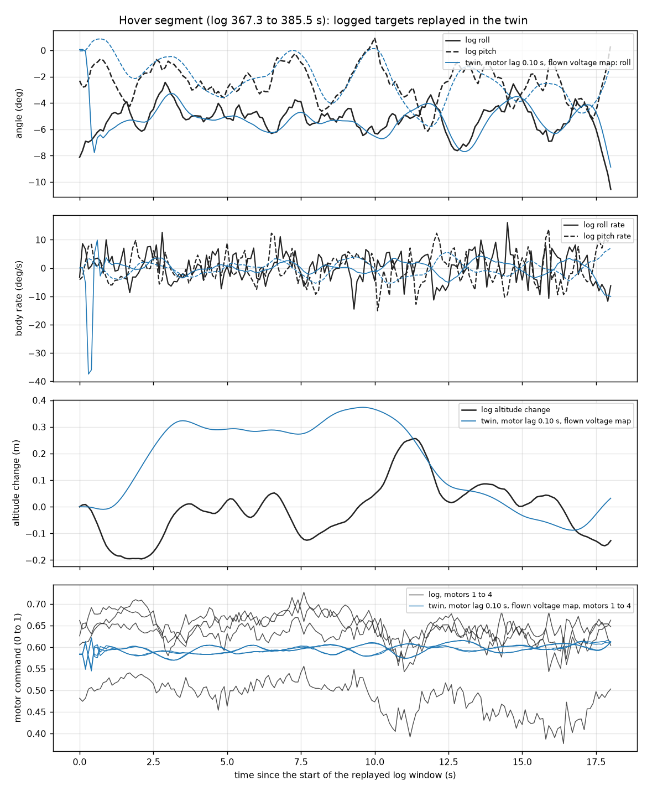

# Redback digital twin: validation report

Date: 2026-10-17. Step 6 of the Redback twin plan. Detail pages: [power/results.md](power/results.md) and [control/results.md](control/results.md).

## 1. Summary

1. **The log holds no electrical power.** No log of the fleet (66 logs) has a working current sensor. So the factor between the maker power and the real power is not measured. An energy bracket from the start and end pack voltage replaces it.
2. **The data do not support the claim that the maker understates power.** The energy bracket for flight 00000171 is 921 to 950 W mean power. The maker model gives 1041 W in hover and 1107 W over the mission mix, both at 40 C. Most models are 6 to 20 % above the bracket. Only the maker datasheet value (930 W) and the Mk4 sheet (970 W) sit inside or near it. The bracket has a limit: a table error of 4 to 6 points of SOC would remove the gap.
3. **The SITL twin is unstable because its motor lag is too large.** The JSBSim engine holds power constant. That gives a lag of 0.26 s. A voltage-driven motor gives 0.10 s. The twin is stable for lags below about 0.2 s. With 0.26 s the roll and pitch phase margin is about -3 deg. With 0.10 s it is +19 deg.
4. **The real aircraft flew with the voltage compensation at its lower limit.** The autopilot read 16 V on battery instance 0 for the whole flight. So lift_max stayed at 0.69 and the controller output gain went up. MOT_BAT_IDX is 0, so the compensation follows this broken monitor. Fix it before the next flight. The twin needs pin overrides to reproduce this.
5. **The real aircraft probably flew near its stability limit.** The log shows a lightly damped 2.0 Hz mode. The linear model with the as-built plant peaks at 1.8 Hz. No linear case reaches the 45 deg phase margin goal for the attitude loops.
6. **The MAD chart curve "P" is output power, not input power.** The first propulsion build read it as input power. It understated shaft power by about 17 %. The fix is the transcription of the five maker bench tables. All numbers in this report use the corrected data.
7. **In forward flight the twin needs more command than the real aircraft.** At 30 deg of tilt the mean command is 0.81 in the twin and 0.65 in the log. In hover they agree (0.597 and 0.599). The twin has no edgewise-flow model for the rotors.

## 2. Scope and inputs

### 2.1 Aircraft and flight

| Item | Value |
|---|---|
| Aircraft | Redback Mk4, X quad, 9.134 kg (weight sheet) |
| Motor | MAD M6C10 IPE V3, KV150 |
| Propeller | MAD FLUXER PRO 22x6.6 |
| ESC | AMPX 40A, PWM |
| Battery | 12S3P, six NXE 6S 4500 mAh packs (13.5 Ah, 44.4 V nominal) |
| Autopilot | CubeOrangePlus, ArduCopter 4.7.0 |
| Flight | 00000171, 2026-09-15, Skyway Range Flight 1, AUTO mission |
| Airborne time | 14.4 min |
| Air temperature | 40 C (user fact) |
| Pack voltage | 4.2 V per cell at start, 23.1 V per 6S at end (user facts) |
| Pilot and site of record | not stated |

The aircraft was not weighed for this flight. The 9.134 kg comes from the weight sheet.

### 2.2 Identifiers

| Item | Value |
|---|---|
| Log sha256 | 215616e25dd4532d0256e1ae4e9572d2cd73d8774ea1ae4c4b2642549ef0a57d |
| Package | redback 0.2.0, Aerolink profile hash 2cc698f0e41b692d |
| Package file sha256 | d20ec190cb39a7582b0222e68b25e09850c665855992e5dc34577396c64781be |

Every number in this report refers to this log and this package unless the text says otherwise.

### 2.3 Tool chain

| Tool | Job in this work |
|---|---|
| AeroPlan | Single source of truth. It holds the aircraft file, builds package 0.2.0 and keeps these reports. |
| Propalyser | Motor chain from the maker tables. It fits kappa and R_tot and exports the propulsion file. |
| Proptimiser | Blade element momentum (BEMT) model of the propeller. Fit B and Fit C. A live CasADi call gives thrust and torque. |
| AeroSandbox | Multirotor jobs with the EMST method of Bershadsky et al. 2016. It calls the Proptimiser model for each rotor. |
| Aerolink | JSBSim and ArduCopter SITL twin. It reads logs and holds the battery model and the accontrol margin model. |

### 2.4 Truth hierarchy

The flight log is the reference. The maker table and the Mk4 estimate sheet are estimates. When they disagree, the log wins. The maker calls its values "theoretical values, for reference only" and gives no accuracy.

## 3. Propulsion model

### 3.1 The chart error and its correction

The first build read the MAD datasheet chart by eye. It took the curve "P" as input power. The bench tables show that "P" is output (shaft) power. At 100 % throttle the FLUXER PRO 22x6.6 row gives 23.91 A, 1144.0 W in and 946.6 W out. The ratio 946.6 W to 23.91 A is 39.6 V. That is the "40 V" that the chart seemed to show.

The effect was a 17 % low shaft power and 176 W of hover input for each motor. The table gives 220 W. The fix has three steps:

1. Type the five maker bench tables (75 rows) into one file.
2. Delete the chart file. Keep Proptimiser Fit B, which used the chart, as a comparison case only.
3. Fit the motor chain and the propeller model to the tables.

### 3.2 Maker table gates and the chain fit

| Gate | Result |
|---|---|
| V1, rows check themselves within the printed digits | Fails. The printed input power is below V times I by 0.4 W on average. |
| V2, rpm from torque, 75 rows | Fails. The rpm RMS is 3.36 % against a limit of 3 %. |
| V3, chain against the 15 FLUXER 22x6.6 rows | Passes. It is in-sample. |

The fitted constants are kappa 0.983 and R_tot 0.432 ohm. R_tot is the sum of motor, ESC and lead resistance. The maker value for the motor alone is 0.120 ohm. The overall gate result is FAIL, and the file is still written.

### 3.3 Fit B and Fit C

Fit B used the wrong target. Fit C uses the maker table. The values below compare each fit with the 15 maker rows.

| Measure | Fit B | Fit C |
|---|---|---|
| Thrust against rpm, RMS | 4.7 % | 1.1 % |
| Shaft power against rpm, RMS | 1.9 % | 0.8 % |
| Power at 22.4 N | 175.6 W (-8.5 %) | 188.9 W (-1.5 %) |

Fit C is in-sample. The fit and the check use the same 15 rows. The blade sections are assumed to be Clark-Y. No source confirms this for the FLUXER. No data at J above 0 exist. All such values are BEMT extrapolation.

### 3.4 Hover power of four rotors

The maker datasheet and the Propalyser chain values are at 48 V. The EMST and live values use the nominal pack of 44.4 V. The 40 C column uses the factor 1.057 for the density 1.097 kg/m3. This factor is a momentum scaling. Nobody checked it with the live Fit C model.

| Source | ISA (W) | 40 C (W) |
|---|---|---|
| Maker table (EMST hover) | 985 | 1041 |
| Fit C, live | 1022 | 1080 |
| Fit B, live | 951 | 1005 |
| Propalyser chain (3244 rpm) | 983 | 1039 |
| Maker datasheet at 3244 rpm | 880 | 930 |
| Mk4 sheet (estimate) | 918 | 970 |

The chain overstates input power at hover by 12 % against the table value for the same rpm. The cause is one R_tot for all loads. For input power at hover, read the table.

### 3.5 ESC end points

The ESC end points are 1050 and 1940 us. They come from MOT_PWM_MIN and MOT_PWM_MAX in the log parameters. The twin must use them. The servo limits (1100 and 1900 us) give a 4.5 point error at the spin-arm value.

## 4. Flight validation: power

### 4.1 Why the log has no power

| Needed | State in the logs |
|---|---|
| Pack current | None. Pins 15 and 4 read 0 A. Pin 14 reads a constant 1.33 V. |
| Pack voltage | Good on battery instance 1 in 19 logs only. |
| rpm | No RPM or ESC message in any log. |
| Mass per flight | Not recorded. |
| Air temperature | Not logged. The 40 C is a user fact. |

### 4.2 Fleet scan

The scan read 66 logs (831 MB). Of 186 battery instances, none has a working current. The pack voltage worked on instance 1 in 19 logs from 2026-05-13 to 2026-07-24. In those logs the multiplier was 19.07 or 18.96. From 2026-08-05 the multiplier is 15. Instance 1 then reads 49.5 V and 66 A, which is the ADC limit. So flight 00000171 has no pack voltage. The full table is in [power/batt_monitor_scan.csv](power/batt_monitor_scan.csv).

### 4.3 Energy bracket

The bracket uses the start SOC of 100 % and the end SOC of 65.1 % from the table. The capacity is 13.5 Ah. The flight lasts 861.6 s.

| Item | Value |
|---|---|
| Charge used | 4709 mAh (half width 441 mAh for 0.05 V) |
| Mean current | 19.7 A (17.5 to 21.8 A) |
| Mean power at 46.8 V to 48.3 V | 921 to 950 W |

The pack voltage under load is not logged. The 48.3 V is the mean of the start and end rest voltage. The lower value assumes 1.5 V of sag. The sag is an assumption.

The flight was mostly cruise, so the mean is not the hover power. The maker model gives 1047 W over the mission mix at ISA and 1107 W at 40 C.

| Model at 40 C | Power (W) | Model divided by bracket |
|---|---|---|
| Maker table, hover | 1041 | 1.10 to 1.13 |
| Maker table, mission mix | 1107 | 1.17 to 1.20 |
| Fit C, hover | 1080 | 1.14 to 1.17 |
| Fit B, hover | 1005 | 1.06 to 1.09 |
| Propalyser chain, hover | 1039 | 1.09 to 1.13 |
| Maker datasheet, hover | 930 | 0.98 to 1.01 |
| Mk4 sheet, hover | 970 | 1.02 to 1.05 |

### 4.4 Command agreement

The motor command needs no battery data. The log command is (PWM - 1050) / 890, averaged over the four outputs.

| Segment type | Model at 40 C | Log | Log over model |
|---|---|---|---|
| Hover | 0.611 | 0.605 | 0.99 |
| Survey, 5.9 m/s | 0.612 | 0.602 | 0.98 |
| RTL cruise, 10 m/s | 0.620 | 0.614 | 0.99 |
| Transit, 16.7 m/s | 0.643 | 0.596 | 0.93 |
| Takeoff climb, 2.6 m/s | 0.647 | 0.604 | 0.93 |

The model agrees with the log in hover and at low speed. At transit speed the log command is 7 % lower than the model.

### 4.5 Conclusion and limits

The maker hover power matches the energy only when the end SOC is 61.1 %. The mission mix matches at 58.7 %. The table gives 65.1 %. The data do not support the statement that the maker understates power. If the bracket is correct, the models are 6 to 20 % high at the site. The limits are:

- The OCV table is for another cell at 25 C. The table reads low after a discharge, so a real cell at 3.85 V sits at a lower SOC.
- The sag under load is unknown.
- The start SOC of 100 % is a user fact. The table ends at 4.144 V.

## 5. Battery model

Aerolink uses the OCV table from Galeotti et al. 2023. The table comes from five LP-503562-IS-3 cells, which are 1.1 Ah pouch cells at 25 C. It is not the Redback cell. The dataset has no rest voltage. The table holds the first sample of the next discharge plus the voltage drop of the dataset circuit fit. The curve is flat from 40 to 50 % SOC, so a small voltage error gives a large SOC error.

The state-of-charge model is that of Xing et al. 2014. The circuit is an internal resistance with an offset and has no RC branch. An unscented Kalman filter (UKF) estimates the state [SOC, R].

The model could not run on this log. The first five seconds of battery instance 0 give 1.338 V per cell, which is outside the table. Instance 1 has a constant current, so the sag fit has no excitation. So Rb, the Xing R and C, and the current scale are not fitted.

The one battery result is the end check. A rest voltage of 23.1 V per 6S is 3.850 V per cell. The table gives SOC 65.1 % (range 64.6 to 65.6 %). The charge remaining is 8791 mAh of 13500 mAh.

## 6. Flight validation: control

### 6.1 The SITL instability

The as-built twin holds a 10 m hover for 12 s. Then a pitch and roll oscillation grows at 0.41 per second and 1.25 Hz. It reaches a limit cycle of +/-30 deg.

The cause is the motor and propeller lag. The JSBSim constant-power engine gives 0.26 s at hover. A voltage-driven motor with Kv 150 and R_tot 0.432 ohm gives 0.10 s with the same inertia. The twin is stable for lags of 0.10, 0.15 and 0.20 s. It is unstable at 0.26 s. A propeller ixx of 0.00049 kg m^2 gives the 0.10 s lag.

### 6.2 Voltage compensation

The autopilot read 16 V on battery instance 0 for the whole flight. So the voltage ratio sat at the lower limit 0.81 (40.8 V over 50.4 V). The motor library held lift_max at 0.69, and the controller output gain went up by 1.22.

The twin sets SIM_BATT_VOLTAGE from MOT_BAT_VOLT_MAX. The flight file reads the battery on pins 14 and 15, and SITL has its battery on pins 13 and 12. So the SITL monitor reads nothing and lift_max stays at 1.0. The twin hover throttle output is then 0.302 against 0.212 in the log. The override SIM_BATT_VOLTAGE alone has no effect. With the four pin overrides in a scratch twin, lift_max is 0.689 and the throttle output is 0.214.

### 6.3 Inertia

| Case | Ixx | Iyy | Izz (kg m^2) |
|---|---|---|---|
| Package as built | 0.2561 | 0.2935 | 0.5430 |
| Bound, 3.831 kg moved to the four hubs | 0.7930 | 0.9096 | 1.6929 |

The bound is a ceiling that no real layout reaches. Inertia is not a lever for stability. A factor of 2.2 on inertia with the lag at 0.26 s is still unstable. With the lag at 0.10 s it is stable.

### 6.4 Margins

The loop is broken at the actuator. The goals are phase margin 45 deg, gain margin 6 dB and Ms 2.0.

| Case | Roll rate PM (deg) | Roll attitude PM (deg) | Pitch attitude PM (deg) | Yaw attitude PM (deg) | Altitude PM (deg) |
|---|---|---|---|---|---|
| As built, lift_max 1.0, lag 0.26 s | 21.6 | -3.3 | -3.7 | -17.9 | 56.7 |
| As built, flown map (lift_max 0.69) | 20.4 | -2.1 | -2.5 | -18.9 | 56.7 |
| Lag 0.10 s, flown map | 32.9 | 18.7 | 19.1 | -1.2 | 88.8 |
| Lag 0.20 s, flown map | 23.9 | 3.9 | 3.7 | -13.0 | 67.1 |

No case meets the 45 deg goal for the attitude loops. The yaw margin of about -1 deg comes from the model. The yaw angle limit is not in it, and SITL holds yaw.

### 6.5 Frequency response

The log rates are 10 Hz for attitude and rate data, and 25 Hz for the IMU. The frequency response needs 100 Hz. So every response stops at 5 Hz.

- The roll rate PSD has a narrow peak at 2.0 Hz. The ratio of attitude to attitude target reaches 11 there. The linear model peaks at 1.8 Hz with a ratio of 10.
- The real aircraft probably flew with an effective lag nearer 0.2 s than 0.1 s. The twin at 0.10 s is more damped than the real aircraft.
- The authority fit is not reliable. Roll gives 51 rad/s^2 per mixer unit and pitch gives 112. The twin has 218 and 204. The two axes differ by a factor of 2. Treat the result as "the twin authority is not below the log value".
- The mixer-to-gyro estimate is biased by feedback. It shows the inverse of the controller, not the plant.

### 6.6 Twin against log (Theil U)

The replay sends the logged attitude targets to the twin (lag 0.10 s, flown map). Theil U is 0 for a perfect match. The Aerolink band (`compare.bands`) is 0.3. The table skips the first 4 s.

| Channel | Hover U | Manoeuvre U |
|---|---|---|
| Roll | 0.061 | 0.312 |
| Pitch | 0.127 | 0.033 |
| Yaw change | 0.073 | 0.023 |
| Roll rate | 0.582 | 0.513 |
| Pitch rate | 0.571 | 0.530 |
| Yaw rate | 0.361 | 0.264 |
| Altitude change | 0.717 | 0.340 |
| Motor 3 command | 0.118 | 0.235 |

Attitude and yaw match well. The rate channels have a high U because the log rate is a 10 Hz sample of a noisy signal. The motor 3 bias comes from the CG offset. The thrust centroid in the hover segments is at x = -39 and -57 mm, then +63 and +79 mm. The package puts the CG at the origin. The altitude U is high because the total altitude change is only 0.2 m.

### 6.7 Forward flight and drag

In the manoeuvre segment at 30 deg of tilt the mean command is 0.81 in the twin and 0.65 in the log. The twin propeller table runs only to J 0.47, and JSBSim has no edgewise-flow model.

The drag fit uses ten steady windows at 15.6 to 17.1 m/s. With quadratic drag alone, the coefficient a is 0.081 N/(m/s)^2 and the wind is 5.4 m/s north and 1.1 m/s east. The package placeholder is 0.0516. The data fix the total drag but cannot separate k_rotor_drag from the body drag. So k_rotor_drag is not identifiable from this log.

The SITL twin has no atmosphere offset. It flies at ISA density for the site height (1.156 kg/m3). The user gave 1.10 kg/m3 at 40 C. So the twin thrust per command is about 5 % high.

## 7. Recommendations

### 7.1 Aircraft and next flight (team actions)

1. Set BATT2_VOLT_MULT back to about 19. The value 15 saturates the input at 49.5 V.
2. Find the current input. Pin 4 reads 0 A.
3. Disable or connect battery monitors 1 and 3 (pin 14). They read 15 to 16 V and 12 to 14 V in every log.
4. Check MOT_BAT_IDX. The logged value in `work/ardupilot/redback/00000171_log.parm` is 0. Instance 0 is the monitor that read 16 V. The voltage compensation uses the monitor that this parameter selects.
5. Bench-check the voltage and the current of the working monitor against a meter.
6. Weigh the aircraft with the battery on the day of the flight. Record the air temperature and the ground pressure.
7. Fly the 60 s hover test of [power/results.md](power/results.md). It needs a calibrated current sensor, a 4.2 V per cell charge, 10 Hz logging and a rest voltage 10 minutes after landing. A second hover with 1 kg of ballast separates the mass effect.
8. Set fast logging for attitude and raw IMU. Fly a SystemID chirp on roll, pitch and yaw in calm air.
9. Consider lower rate gains or lower ATC_ANG_*_P. The real aircraft flew near the margin at the default rate gains (P 0.135, I 0.135, D 0.0036).
10. Weigh the CG. The thrust centroid is not at the origin.

### 7.2 Twin and tools

1. Add a voltage-driven motor model to Aerolink. As a stop-gap, use an equivalent propeller ixx of 0.00049 kg m^2.
2. Measure the motor rotor inertia. The contract requires it in the package propeller ixx, which is 0.00128 kg m^2 for the propeller only. A larger value raises the lag.
3. Add the battery pin overrides to the twin config: BATT_VOLT_PIN 13, BATT_CURR_PIN 12, BATT_VOLT_MULT 10.1 and BATT_AMP_PERVLT 17. Then decide the voltage. At the nominal 44.4 V, lift_max is 0.79.
4. Add an atmosphere offset to the bridge for hot-day density.
5. Add an edgewise-flow rotor model for forward flight.
6. Build a new AeroPlan version. The 13 flight segments reach a package only through a new version.

## 8. Open data and decisions

| Item | State |
|---|---|
| Aircraft mark of the July to September logs | Not stated. The parameters do not tell. |
| Takeoff mass per flight | Not recorded. |
| True pack voltage in flight | Not known. Instance 0 read 16 V. |
| Real NXE OCV curve | Not measured. The table is for another cell at 25 C. |
| Motor rotor inertia | Not measured. |
| Placeholder values in package 0.2.0 | 45 |
| ESC type | PWM, confirmed by the user on 2026-10-17. The maker DroneCAN interface did not work for the team. The AeroPlan aircraft page still names the "CAN" product variant. Correct it in the next AeroPlan version. |
| Stand torque (A401) | The data do not support "the stand torque reads too high". A dead-weight calibration of both load cells decides it. |

### Differences between the two result files

1. **lift_max.** Power gives 0.690. Control gives 0.689. This is rounding of the same quantity.
2. **Hover command of the log.** Power gives 0.605 (four windows). Control gives 0.599 for its hover window (367.3 to 385.5 s). The windows differ. The two values agree within 1 %.
3. **Twin hover output with lift_max 1.** Power gives an actuator command of 0.499. Control gives a throttle output of 0.302. They are two different signals in the ArduCopter chain, so they do not contradict.
4. **How to reproduce lift_max 0.69.** Power says that SIM_BATT_VOLTAGE at or below 40.8 V gives the flown map. Control shows that this fails without the pin overrides. Use the control result.
5. **Multiplier 15.** Power says it applies from 2026-08-05. The same file also reports 15.0 to 15.2 for the flights of 2026-07-05.
6. **Hover rpm.** Propalyser gives 3244 rpm at 22.4 N and rho 1.225. Proptimiser gives 3298 rpm from the maker table, which has rho 1.184. The densities differ.

## 9. Traceability

### 9.1 Commits

| Repo | Commit | Subject |
|---|---|---|
| Propalyser | c2b0001 | Improving the redback mk4 implementation |
| Propalyser | a33c19a | mad fluxer pro implementation |
| Propalyser | f31cb25 | updating vendor data |
| Propalyser | 1614997 | Add the ESC end points of the flown Redback Mk4 |
| Propalyser | e27d09d | Write the fitted chain constants in a vendor export |
| Propalyser | 750f532 | Correct the ESC type of the Redback Mk4 to PWM |
| Proptimiser | 86d9468 | fluxerx6.6 prop solve (redback propeller) |
| Proptimiser | 7c1af91 | Initial VTOLCoper Design, fluxer COTS modelling |
| Proptimiser | 321f47a | VTOLCURRAWONG_V0 Preliminary Design Complete (holds Fit C) |
| Aeroplan | 5990340 | initial quadcopter/redback implementation |
| Aeroplan | de33a90 | Build Redback 0.2.0 with the Propalyser, ArduPilot and EMST data |
| Aeroplan | b8e252d | Add the Redback power and battery validation against flight log 00000171 |
| Aeroplan | 22323f0 | Update the Redback power report with the fleet log scan and the user facts |
| Aeroplan | 54c457d | Add the Redback control validation against flight log 00000171 |
| Aerolink | 680791e | introduce xing_soc for battery eval |
| Aerolink | 3d98e97 | Fill in the Redback twin and add the real package |
| Aerolink | 67bb5e2 | Require the harmonic notch parameters only when the notch is on |
| Aerolink | 9c8f58c | Add the battery voltage compensation to the ArduCopter loop gain |
| Aerolink | 5598a76 | Add a scan of flight logs for a working battery monitor |

### 9.2 Hashes

| Item | sha256 |
|---|---|
| Flight log 00000171.BIN | 215616e25dd4532d0256e1ae4e9572d2cd73d8774ea1ae4c4b2642549ef0a57d |
| Parameter file 00000171_log.parm | 3592de49e0fa3bedf37e3baac96ad93658b6368cd131ed73b0e359bcdaee3e13 |
| Package redback.muas 0.2.0 | d20ec190cb39a7582b0222e68b25e09850c665855992e5dc34577396c64781be (profile hash 2cc698f0e41b692d) |
| Propalyser export | 096c9704c18b123ce40c1d34d89c771f1472b1d418f80c24aef0734d4d7779d4 |
| Proptimiser export | 7c9f0f6b061c44dd348d10370b67dc08dc0de1a5599b086550a18ea70a80b624 |

## 10. References

- D. Bershadsky, S. Haviland and E. N. Johnson, "Electric multirotor UAV propulsion system sizing for performance prediction and design optimization", AIAA 2016-0581. The Aerolink reference file says to check the number against the DOI before you cite it.
- M. Galeotti, L. Cina, C. Giammanco, A. Di Carlo, F. Santoni, A. De Angelis, A. Moschitta and P. Carbone, "LiPo batteries dataset: Capacity, electrochemical impedance spectra, and fit of equivalent circuit model at various states-of-charge and states-of-health", Data in Brief, 50, 2023, 109561, doi:10.1016/j.dib.2023.109561.
- Y. Xing, W. He, M. Pecht and K. L. Tsui, "State of charge estimation of lithium-ion batteries using the open-circuit voltage at various ambient temperatures", Applied Energy, 113, 2014, pp. 106-115, doi:10.1016/j.apenergy.2013.07.008.
- D. G. Murri, E. B. Jackson and R. O. Shelton, "Check-Cases for Verification of 6-Degree-of-Freedom Flight Vehicle Simulations", NASA/TM-2015-218675, Volumes I and II, NASA Langley Research Center, 2015 (NESC-RP-12-00770).
- R. V. Jategaonkar, "Flight Vehicle System Identification: A Time-Domain Methodology", 2nd ed., AIAA, 2015. This is the source of Theil's inequality coefficient in Aerolink `docs/methods.md`, together with V. Klein and E. A. Morelli, "Aircraft System Identification: Theory and Practice", AIAA, 2006.
- MAD Components, M6C10 IPE V3 KV150 datasheet with five bench tables at 12S and the AMPX 40A ESC. The image is in the Propalyser component folder `components/motors/MAD_M6C10_IPE_V3_KV150/vendor/datasheet_full.png`. The user supplied it on 2026-10-17.
