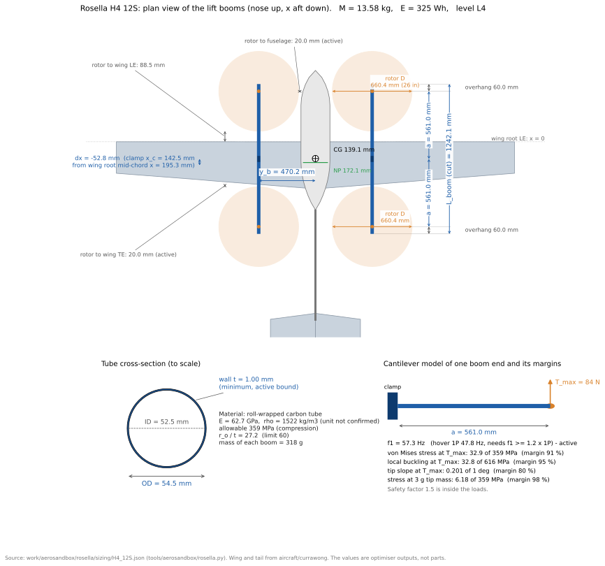

# Rosella sizing optimiser: method report

Date: 2026-10-18. Script: `tools/aerosandbox/rosella.py`. Settings: `tools/aerosandbox/settings/rosella.yaml`. Decision: [ADR 22](../../decisions/0022-quadplane-path.md). Operating steps: [Size a quadplane](../../howto/size-a-quadplane.md).

**Note of 2026-10-21.** [ADR 24](../../decisions/0024-aircraft-models-in-code.md) replaced the script, the YAML settings file and the manual file. The same equations now run in `QuadplaneModel` (`tools/aerosandbox/model.py`). The study is the notebook `tools/aerosandbox/notebooks/rosella_sizing.ipynb`. The stiffness rule f1 >= 1.2 x 1P of this report was replaced by a hover band (f1 below hover 1P less 20 %). The file names below are those of the date of the report.

The numbers in section 6 come from the run of 2026-10-18 (log `work/aerosandbox/rosella/optimise_cant.log`, results in `work/aerosandbox/rosella/sizing/`). They are estimates. Many inputs are placeholders (section 7).

## 1. Summary

1. The script sizes the lift propulsion, the battery and the lift booms of the Rosella VTOL quadplane. It minimises the mission energy at a fixed MTOW limit, CG and airframe.
2. It is one nonlinear program (NLP) in AeroSandbox `Opti` (CasADi and IPOPT). It has 11 design variables, about 20 internal state variables and about 60 constraints.
3. The solver climbs a fidelity ladder, L0 to L4: momentum theory, then fitted rotor tables, then full-space BEMT. Each level starts from the result of the level below.
4. The best result that reached L4 is **H4 12S**: 13.58 kg, 325 Wh mission energy, 407 Wh nominal pack, 660 mm (26 in) rotors, Kv 139 rpm/V, 2.41 N m peak motor torque, 9.2 Ah.
5. The rotor diameter sits on its upper bound (26 in) in 7 of 9 cases. So the bound sets the rotor size, not the physics. The blade at 26 in is an 18 % extrapolation of the FLUXER 22x6.6 model.
6. Three cases (H4 14S, H8 8S, H8 12S) fail at L4. The 6S cases fail at L1. Section 8.6 gives the causes.
7. The four largest model gaps for a parts order are: the coaxial loss is not in the H8 motor limits, the boom first mode lies inside the rotor speed band, the air is ISA 15 C (the Redback flew at 40 C), and the neutral point is not certain to better than about 30 % MAC.

## 2. Problem statement

### 2.1 Aircraft

| Item | Value | Source |
|---|---|---|
| Wing, tail, tail boom | Currawong V1, read from `aircraft/currawong` | ADR 22 |
| Fuselage | New superellipse body (n = 2.5), 0.24 m x 0.18 m | placeholder: Currawong V1 maximum section |
| Cruise propulsion | Currawong nose motor MAD X5220 220KV and Currawong_V1 propeller, fixed | `aircraft/currawong` 1.2.3.9 |
| Lift booms | Two carbon tubes parallel to x at y = ±y_b, level with the tail boom axis, clamped to the wing | user decision 2026-10-17 |
| H4 | One lift rotor at each boom end (4 rotors) | ADR 22 |
| H8 | A coaxial pair at each boom end (8 rotors), spacing 0.25 D | Brazinskas et al. 2016 [7] |
| Cells | 6S, 8S, 10S, 12S, 14S, each a separate case | ADR 22 |

Design frame: x aft, y right, z up, origin at the wing root leading edge (ADR 23). SI units.

### 2.2 Mission

The mission is Redback flight 00000171 (2026-09-15) with 10 endurance laps in place of 1.

| Segment | Model | Numbers |
|---|---|---|
| VTOL climb | state C_TO | 30 m at 2.5 m/s |
| Transitions | state H_TO for 2 x 15 s | 30 s |
| Fixed-wing climb | lap power plus potential energy | 93 m total height at 2.6 m/s |
| Transit, laps, return | state F_LAP | 656 m + 10 x 3370 m + 660 m |
| Survey | state F_MAP with turns | 6 lines x 259 m, 30 deg bank turns, radius 40 m (placeholder) |
| Deployment hover | state H_L (landing mass, cargo gone) | 60 s |
| Landing | state H_L | 30 m at 1.5 m/s |
| Reserve | state H_L | 300 s hover |
| Thrust check | state MAX | T/W 2.5 at end-of-discharge voltage |

### 2.3 Objective

$$\min\; E_{total} = \sum_{seg} P_{seg}\, t_{seg}$$

The solver scales the objective as $E_{total}/100\ \text{Wh}$. A constraint dual times 100 over the constraint scale gives `cost_Wh_per_unit`: the energy that one unit of relaxation saves.

### 2.4 Design variables

| Name | Meaning | Bounds | Note |
|---|---|---|---|
| `t_boom` | boom wall | 1.0 to 5.0 mm | 1.0 mm minimum: user decision |
| `r_boom` | boom outer radius | 8 to 45 mm | |
| `y_b` | boom lateral station | 0.35 to 1.0 m | |
| `dx` | boom clamp shift from the wing root mid-chord | ±0.35 m | |
| `a` | clamp-to-hub arm (each end) | 0.25 to 1.0 m | |
| `scale` | rotor radius over 0.2794 m | 0.727 to 1.182 (16 in to 26 in) | user decision |
| `kv` | motor Kv | 60 to 450 rpm/V | survey range |
| `q_cap` | motor peak torque capacity | 0.5 to 9.0 N m | survey range |
| `cant` | lift rotor tilt for yaw | 0 to 10 deg | ADR 22 |
| `cap_Ah` | pack capacity | 2 to 60 Ah | |
| `x_batt` | battery x | bay −0.45 to 0.40 m | placeholder bay |

Internal variables: the peak motor current `I_pk`, the speeds `V_lap` and `V_map`, and the shaft speed of every rotor at every state (`w_<state>`).

## 3. Component models

### 3.1 Motor (refit of Bershadsky Eq. 1)

AIAA 2016-0581 Eq. 1 [1] gives motor mass from Kv only. Its low-Kv curve has no published coefficients. So the script refits three log-linear relations on `data/motor_survey.csv` (38 rows inside Kv 60 to 450 rpm/V and mass 150 to 1600 g):

$$q_{cap} = \frac{I_{max} - I_0}{K_v}\quad(K_v\ \text{in rad/s/V})$$

$$m_{motor} = e^{a_0} K_v^{a_1} q_{cap}^{a_2},\qquad R_m = e^{b_0} K_v^{b_1} m^{b_2},\qquad I_0 = e^{c_0} K_v^{c_1} m^{c_2}$$

| Fit | Coefficients (latest run) | RMS of the log error |
|---|---|---|
| mass (g) | 3.416, 0.327, 0.806 | 0.175 |
| R_m (Ohm) | 11.54, −1.317, −1.308 | 0.248 |
| I_0 (A) | −7.060, 0.628, 0.690 | 0.319 |

`I_max` is the 180 s peak current where the maker gives one. The fit includes the q_cap term because Kv alone does not set the mass of a low-Kv motor.

### 3.2 Propeller mass

AIAA 2016-0581 Eq. 5 [1], carbon, D in inch, mass in g. The paper gives no p3, so p3 = 0:

$$m_{prop} = 0.1207\,D^2 - 0.5122\,D$$

### 3.3 ESC mass

AIAA 2016-0581 Eq. 2 [1], with a 1.2 rating factor (placeholder):

$$m_{ESC} = 0.8421\ \text{g/A} \times 1.2\, I_{pk}$$

### 3.4 Battery

AIAA 2016-0581 Eq. 4 [1], calibrated to the NXE 6S 4500 mAh pack (0.631 kg):

$$m_{batt} = k_{cal}\,(p_1 S + p_2)\,C,\qquad k_{cal} = \frac{0.631\ \text{kg}}{(6 p_1 + p_2)\cdot 4500}$$

with p1 = 0.026373, p2 = 2.0499e-5, C in mAh. Pack resistance (cell resistance 5 mOhm at 4.5 Ah, placeholder):

$$R_b = S\, r_{cell}\, \frac{4.5}{C_{Ah}}$$

Nominal energy $E_{nom} = S\,V_{cell}\,C$ with $V_{cell}$ = 3.7 V. The bay check uses 330 Wh/L (placeholder).

### 3.5 Cables

Copper area from a current density J = 10 A/mm² (placeholder). Each run goes from the battery to a hub:

$$A_{cu} = \frac{I_{pk}}{J},\qquad L_{run} = \sqrt{(x_{hub}-x_{batt})^2 + 10^{-4}} + y_b + l_{over} + |z_b| + l_{extra}$$

$$m_{wire} = f_{ins}\sum_{runs} 2\cdot 2\, n_{per}\, L_{run}\, \rho_{cu} A_{cu},\qquad R_w = \frac{\rho_e\, 2 L_{run}}{A_{cu}}$$

ρ_cu = 8960 kg/m³ and ρ_e = 1.724e-8 Ohm m (IACS, 20 C). The order sheet gives the AWG from ASTM B258 [16]: $d = 0.127\ \text{mm}\cdot 92^{(36-n)/39}$.

### 3.6 Airframe and fuselage

- Kept Currawong items: wing and tail point masses, tail boom, avionics, from the `aircraft/currawong` mass model.
- Fuselage shell: wetted area times 1.0 kg/m² (placeholder).
- Boom: $m = \rho\, \pi (r_o^2 - r_i^2)\, L$ with $L = 2a + 2 l_{over}$.
- Fixed items: clamp 60 g, mount 45 g, VTOL avionics 350 g, landing gear 0.60 kg (all placeholders).

### 3.7 Mass, CG and inertia

All items are point masses with an own inertia where it matters (booms, fuselage, tail boom, battery as slender bodies, $mL^2/12$). Totals use the parallel axis theorem about the design CG:

$$M = \sum m_i,\qquad I_{yy} = \sum \left[I_{yy,i} + m_i\left((x_i - x_{cg})^2 + z_i^2\right)\right]$$

## 4. Aerodynamic and rotor models

### 4.1 Neutral point and design CG

The script runs a vortex lattice (VLM, 16 x 12) of the wing, the horizontal tail and the fin. It adds the body term of the fuselage and tail boom from AeroBuildup. Two angles (0 and 4 deg) give:

$$x_{np} = x_{ref} - \bar c\,\frac{\Delta C_m}{\Delta C_L},\qquad x_{cg} = x_{np} - SM\cdot\bar c$$

SM = 0.10 (user decision, placeholder). The CG is an equality constraint. The battery x and the boom shift dx close it:

$$\sum m_i x_i - x_{cg} M = 0$$

Latest run: x_np = 0.172 m, x_cg = 0.139 m, MAC 0.330 m.

### 4.2 Cruise polar

AeroBuildup of the full airframe at 17 m/s, alpha −2 to 12 deg. A least squares fit over CL 0.2 to 0.9 gives a parabolic polar [15]:

$$C_D = C_{D0} + k\,C_L^2$$

Latest run: CD0 = 0.0138, k = 0.0398, CL at 12 deg = 1.457. The usable CL_max is 0.85 times this value (placeholder). The lift booms, nacelles and stopped rotors add drag areas:

$$C_DA_{boom} = 2\, FF\, C_f\, (2\pi r_o)\, L,\quad C_DA_{nac} = N\cdot 0.001\ \text{m}^2,\quad C_DA_{prop} = N\cdot 0.01\, R^2$$

FF = 1.2 (Hoerner [14]) and Cf = 0.0045. All three are placeholders.

### 4.3 Cruise states

$$q = \tfrac12\rho V^2,\quad C_L^2 = \frac{(Mg)^2\, \bar{n^2}}{(qS)^2},\quad D = q\left[S\,(C_{D0} + k C_L^2) + C_DA_{extra}\right]$$

For the survey, $\bar{n^2}$ mixes the straight lines (n = 1) and the turns ($n = 1/\cos 30°$) by distance. Both cruise speeds must satisfy $V \ge 1.3\,V_s$ with $V_s = \sqrt{2W/(\rho S C_{L,max})}$. The lift rotors are stopped. The nose propeller gives T = D.

### 4.4 Lift rotor: the three models

The lift blade is a geometric scale of the Proptimiser `MAD_FLUXER_22x6_6_jung` blade (R = 0.2794 m, P/D 0.30). Its chord and twist have the mean shape of the Jung et al. 2021 T-motor blades, with a chord scale and two twist parameters fitted to the MAD FLUXER 22x6.6 maker table (k_chord 1.158, k_twist 0.962, dtheta -1.81 deg). The scale is $s = R/0.2794$.

**Momentum (L0).** Actuator disc with a constant figure of merit [6]. FM and the hover CT come from one BEMT solve of the base blade at 435 rad/s:

$$P = \frac{T}{FM}\left(\frac{V}{2} + \sqrt{\left(\frac{V}{2}\right)^2 + \frac{T}{2\rho A}}\right),\qquad \omega = \frac{2\pi}{D^2}\sqrt{\frac{T}{C_{T0}\,\rho}}$$

**Table (L1 to L3).** Numeric Proptimiser solves at 5 shaft speeds, 3 scales and 2 axial speeds. Polynomials of degree 3 in the tip Mach number and the advance ratio, plus terms in ln s:

$$T = C_T(M_{tip}, J, \ln s)\,\rho n^2 D^4,\qquad P = C_P(M_{tip}, J, \ln s)\,\rho n^3 D^5$$

**Full-space BEMT (L3 for H_TO, L4 for all states).** The Proptimiser blade element model with NeuralFoil [3] section data goes into the NLP. The inflow at each station is an Opti variable. One azimuth station (`n_psi = 1`) gives axial flow only.

At each state the rotor must give the target thrust: $T(\omega, V, s) = T_{target}$. The shaft speed is the free variable.

### 4.5 Cruise rotor

The same three models apply. The table fits CT and CP of the Currawong_V1 blade in J and M_tip for J ≤ 0.6, because CT goes below zero above J = 0.6. The momentum level uses the BEMT propulsive efficiency at 17 m/s and 18 N.

## 5. Constraints

### 5.1 Hover thrust share

Each boom end carries the share of the weight that the moment balance about the CG gives. The cant costs $1/\cos(\text{cant})$ of thrust:

$$T_f = \frac{W}{2\, n_{per} \cos(\text{cant})}\cdot\frac{x_r - x_{cg}}{x_r - x_f},\qquad T_r = \frac{W}{2\, n_{per}\cos(\text{cant})}\cdot\frac{x_{cg} - x_f}{x_r - x_f}$$

### 5.2 Motor and electrical chain

AIAA 2016-0581 Eq. 9 to 11 [1], one rotor:

$$I = Q\,K_v + I_0,\qquad V_m = \frac{\omega}{K_v} + R_m I,\qquad P_e = V_m I + (R_e + R_w) I^2$$

Battery power and current, with the coaxial factor $k_{int}$ = 1.28 for H8 [7] (1.0 for H4):

$$P_b = k_{int}\cdot 2 n_{per}\sum_{f,r} P_e + P_{av} + R_b I_b^2,\qquad I_b = \frac{P_e^{tot}}{S\,V_{cell}}$$

| Constraint | Expression | Limit | Source |
|---|---|---|---|
| Motor torque (MAX) | $Q_{MAX}$ | ≤ q_cap | survey peak rating |
| Motor current (MAX) | $I_{MAX}$ | ≤ I_pk | |
| ESC duty (MAX) | $\left(\omega/K_v + (R_m + R_e + R_w) I\right)/V_{bus}$, $V_{bus} = S V_{end} - R_b I_b$ | ≤ 0.95 | placeholder |
| Pack C-rate (MAX) | $I_{b,MAX}/C$ | ≤ 25 | NXE 6S 4500 25C listing |
| Tip Mach (all states) | $\omega R / a_0$ | ≤ 0.65 | placeholder |
| Cruise motor duty | $V_m / (S V_{cell} - R_b I_b)$ | ≤ 0.95 | placeholder |
| Cruise motor current | $I$ | ≤ 72.4 A | X5220 continuous |
| Cruise tip Mach | | ≤ 0.85 | |

The MAX state uses $V_{end}$ = 3.5 V per cell (placeholder) and T/W 2.5.

### 5.3 Mass, energy and volume

| Constraint | Expression | Limit | Source |
|---|---|---|---|
| MTOW | $M$ | ≤ 15.0 kg | user requirement |
| CG | $\sum m_i x_i = x_{cg} M$ | equality | section 4.1 |
| Energy | $E_{total}$ | ≤ 0.80 $E_{nom}$ | placeholder usable fraction |
| Stall | $V_{lap}, V_{map}$ | ≥ 1.3 V_s | user plan |
| Bay volume | $E_{nom}/330$ | ≤ 40 % of the bay box | placeholder |

### 5.4 Boom structure

Each boom end is a cantilever of length a from a rigid clamp. Two load cases at each end: the MAX thrust, and 3 g on the tip mass. SF = 1.5 (placeholder):

$$M_b = SF\sqrt{\left(F a + n_g g\, m_{arm}\frac{a}{2}\right)^2 + Q_e^2},\qquad \sigma = \frac{M_b\, r_o}{I},\qquad \tau = \frac{SF\, F\, e\, r_o}{2I}$$

$$\sigma_{vm} = \sqrt{\sigma^2 + 3\tau^2} \le \min(\sigma_t, \sigma_c)$$

$I = \tfrac{\pi}{4}(r_o^4 - r_i^4)$, e is the 20 mm thrust line offset (placeholder), $Q_e$ is the rotor torque at the end.

Local buckling, classical thin cylinder [11] with a knockdown of 0.5 (placeholder, NASA SP-8007 [12]):

$$\sigma \le \sigma_{cr} = 0.605\, E_c\,\frac{t}{r_{mid}}\,\gamma$$

Tip slope and wall ratio:

$$\theta_{tip} = \frac{F a^2}{2 E I} \le 1.0°,\qquad r_o/t \le 60$$

First bending frequency, Rayleigh method with the 33/140 effective beam mass [13]:

$$f_1 = \frac{1}{2\pi}\sqrt{\frac{3EI}{a^3\,(m_{tip} + 0.236\, m_{arm})}} \ge 1.2\, f_{1P,hover}$$

Material: Rock West roll-wrapped tube SKU 45026, E = 62.7 GPa, compressive E = 54.5 GPa, 372 MPa tension, 359 MPa compression [17].

### 5.5 Clearances (plan view)

The gap g is 20 mm (placeholder):

$$y_b - R - \tfrac12 w_{fus} \ge g,\quad x_{LE}(y_b) - (x_f + R) \ge g,\quad (x_r - R) - x_{TE}(y_b) \ge g$$

$$x_{htail,LE} - (x_r + R) \ge g,\qquad 2a - 2R \ge g$$

The front disc stays ahead of the wing leading edge and the rear disc stays behind the trailing edge. So no rotor wake falls on the wing in hover.

### 5.6 Hover control authority

Ivler et al. [8] give the ADS-33E-PRF [9] attitude bandwidth (2 rad/s, Level 1) with Froude scaling to a small UAS. The script converts it to an angular acceleration:

$$\omega_{bw} = 2\sqrt{\frac{11.9\ \text{m}}{L_{hub}}},\qquad L_{hub} = \sqrt{(2y_b)^2 + (2a)^2},\qquad \alpha_{req} = 1.2\,\omega_{bw}^2\,\phi_{amp}$$

$\phi_{amp}$ = 10 deg (placeholder). Each rotor thrust can move by $\Delta T = (1 - 0.15)\,T_h$ (idle fraction placeholder):

$$\frac{N y_b \Delta T}{I_{xx}} \ge \alpha_{req},\qquad \frac{N a\, \Delta T}{I_{yy}} \ge \alpha_{req}$$

Yaw comes from the drag torque difference ($Q \propto T^{3/2}$, momentum theory) plus the tangential component of the canted thrust (ADR 22, after Niemiec and Gandhi [10]):

$$M_z = \frac{N}{2} Q_h\left[(1+d)^{3/2} - (1-d)^{3/2}\right] + N\,\Delta T \sin(\text{cant})\,\frac{\rho_f + \rho_r}{2} \ge 1.5\ \text{rad/s}^2 \cdot I_{zz}$$

d = 1 − idle. ρ_f and ρ_r are the horizontal distances from the CG to the hubs. The 1.5 rad/s² is a placeholder (user decision after a sweep of 0.5 to 3.0).

## 6. Solution method

### 6.1 Tools

- AeroSandbox `Opti` [2], a layer on CasADi [4], with IPOPT [5] (exact Hessian, MUMPS, adaptive barrier, tol 1e-5, acceptable tol 1e-3).
- Proptimiser (MonashUAS, commit 711ef86) for the BEMT. It adds the radius scale as an Opti parameter.
- NeuralFoil [3] for the section lift and drag.

### 6.2 The fidelity ladder

| Level | Lift rotor | Cruise rotor | Constraint groups |
|---|---|---|---|
| L0 | momentum | momentum | mass, CG, energy, T/W and tip Mach |
| L1 | table | table | L0 + electrical |
| L2 | table | table | L1 + structure, stiffness, clearance, control |
| L3 | BEMT at H_TO, table at the others | table | all |
| L4 | BEMT at all 8 lift states | BEMT at 2 cruise states | all |

Each level has two phases:

1. **Elastic feasibility phase.** Each inequality gets a slack s ≥ 0. The objective is $\min \sum s$. If the largest slack is above 1e-4, the level is infeasible and the report names the constraints with a slack.
2. **Optimality phase.** It starts from the feasibility point with a small barrier ($\mu_0$ = 1e-3). If it fails, one retry uses $\mu_0$ = 0.1.

L0 and L1 use 5 starts (the base start plus 4 random starts in the bounds, seed 20261017). L2 to L4 use one start, the result of the level below. The ladder stops at the first level that fails. The case result is the highest level that converged.

### 6.3 Outputs

Each case writes `L<k>.json` for each level, a result JSON, and an order sheet (Markdown and CSV). A result lists the active constraints (margin below 1e-3), the dual cost of each constraint, the gap to the level below and every placeholder. The command `evaluate` runs the same model with the design fixed to a parts list in `settings/rosella.manual.json`.

## 7. Results (run of 2026-10-18)

| Case | Level reached | M (kg) | E (Wh) | E_nom (Wh) | D (mm) | Kv (rpm/V) | q_cap (N m) | I_pk (A) | C (Ah) | cant (deg) |
|---|---|---|---|---|---|---|---|---|---|---|
| H4 6S | L0 | 11.21 | 262 | 328 | 660 | 60 | 0.96 | 5.0 | 14.8 | 0.1 |
| H4 8S | L4 | 14.68 | 358 | 448 | 660 | 228 | 2.61 | 63.8 | 15.1 | 3.5 |
| H4 10S | L4 | 13.99 | 337 | 421 | 660 | 172 | 2.48 | 45.9 | 11.4 | 3.7 |
| **H4 12S** | **L4** | **13.58** | **325** | **407** | **660** | **139** | **2.41** | **35.9** | **9.2** | **3.8** |
| H4 14S | L3 | 13.28 | 317 | 396 | 660 | 116 | 2.34 | 29.1 | 7.6 | 3.9 |
| H8 8S | L3 | 14.99 | 391 | 489 | 619 | 182 | 1.24 | 24.5 | 16.5 | 3.7 |
| H8 10S | L4 | 14.45 | 364 | 455 | 660 | 125 | 1.28 | 17.4 | 12.3 | 3.7 |
| H8 12S | L3 | 14.14 | 367 | 459 | 612 | 117 | 1.15 | 14.7 | 10.3 | 4.0 |
| H8 14S | L4 | 13.90 | 348 | 435 | 660 | 86 | 1.23 | 11.5 | 8.4 | 3.8 |

Results below L2 have no structure, clearance or control constraints. They are not buildable designs. For example, the H4 6S L0 booms have no stiffness check at all.

### 7.1 H4 10S in detail

| Item | Value |
|---|---|
| Boom | 56.4 mm OD, 1.0 mm wall, y_b = 0.470 m, a = 0.561 m |
| Hubs | x_f = −0.418 m, x_r = 0.704 m, front share 0.503 |
| Hover, each rotor | 34.6 N, 2909 rpm, 303 W shaft, 19.1 A |
| MAX, each rotor | 86.5 N, 2.48 N m, 45.9 A, 1P = 75.7 Hz |
| Boom f1 | 58.2 Hz (hover 1P 48.5 Hz) |
| Battery power | H_TO 1464 W, MAX 6037 W, 158 A (13.9 C) |
| Lap cruise | 17.1 m/s, CL 0.71, drag 8.5 N, 277 W, total efficiency 0.52 |
| Control | α_req 6.8 rad/s², roll 18.1, pitch 16.7, yaw 1.50 rad/s² |
| Masses | battery 2.66 kg, booms 0.66 kg, lift units 2 x 0.50 kg per side, cables 0.58 kg, fuselage 0.64 kg |

Energy by segment:

| Segment | Wh |
|---|---|
| Transit, laps, return | 157.1 |
| Reserve hover (300 s) | 114.9 |
| Deployment hover | 23.0 |
| Transitions | 12.2 |
| Survey | 10.1 |
| Landing | 7.7 |
| Fixed-wing climb | 6.4 |
| VTOL climb | 5.8 |
| **Total** | **337.1** |

Active constraints and their cost:

| Constraint | Wh per unit |
|---|---|
| Rear disc to wing TE clearance | 148 per m |
| ESC duty, rear and front | 41 and 39 per unit duty |
| Motor torque, front | 17 per N m |
| Disc to fuselage clearance | 10.5 per m |
| Yaw acceleration | 2.3 per rad/s² |
| Motor current, front | 0.7 per A |
| Boom f1 over 1P | 0.4 per unit |

The wing chord sets the boom length. The disc clearances to the wing then fix the hub stations.

### 7.2 H4 12S model and boom sizing values

The figure shows the optimiser model of the H4 12S result (level L4, `sizing/H4_12S.json`). The wing, tail and fuselage are drawn from `aircraft/currawong` and the new fuselage of the script. The table lists each value that the figure labels.

| Value | Symbol | Result | Bound or limit | Note |
|---|---|---|---|---|
| Tube outer diameter | 2 r_o | 54.5 mm | r_o 8 to 45 mm | free |
| Tube inner diameter | 2 r_i | 52.5 mm | | r_o − t |
| Wall | t | 1.00 mm | 1.0 mm minimum | active bound |
| Radius over wall | r_o / t | 27.2 | 60 maximum | |
| Arm, clamp to hub | a | 561.0 mm | 250 to 1000 mm | one each end |
| Overhang beyond the hub | | 60.0 mm | placeholder | |
| Cut length of each boom | L_boom = 2a + 2 overhang | 1242.1 mm | | quantity 2 |
| Boom station | y_b | 470.2 mm | 350 to 1000 mm | |
| Clamp position | x_c = mid-chord + dx | 142.5 mm | | wing root LE at 0 |
| Clamp shift | dx | −52.8 mm | ±350 mm | |
| Rotor diameter | 2 R | 660.4 mm | 406 to 660 mm | upper bound, 26 in |
| Mass of each boom | | 318 g | | density 1522 kg/m³ (unit not confirmed) |
| First bending frequency | f1 | 57.3 Hz | 1.2 x hover 1P (47.8 Hz) | active |
| Stress at T_max (84 N) | von Mises | 32.9 MPa | 359 MPa | margin 91 % |
| Local buckling at T_max | σ | 32.8 MPa | 616 MPa | margin 95 % |
| Tip slope at T_max | | 0.20 deg | 1.0 deg | margin 80 % |

Stiffness sets the tube size, not strength. The stress margin is above 90 %. The wall sits on its 1.0 mm lower bound. So the next saving in mass needs a stiffer fibre layup, not a thinner wall.

The scripts `figures/dump_airframe_geometry.py` and `figures/make_boom_figure.py` make the figure. Run the first with the AeroSandbox Python. It writes a geometry JSON. Run the second with a result JSON, the geometry JSON and an output name.

## 8. Inaccuracies and unknowns

### 8.1 Model errors that can change a parts order

1. **The coaxial loss is not in the H8 motor limits.** `k_int` = 1.28 multiplies only the battery power. The motor torque, current and duty limits use the torque of an isolated rotor. So an H8 motor can be up to 28 % too small. The lower rotor thrust share (0.45, placeholder) is not used. Both rotors of a pair carry equal thrust.
2. **The boom first mode is inside the rotor speed band.** The stiffness check uses the hover 1P only. In H4 10S, f1 = 58.2 Hz lies between hover 1P (48.5 Hz) and MAX 1P (75.7 Hz). The boom passes through resonance at each large throttle input. The 2P (blade pass) frequency is not checked.
3. **The air is ISA sea level, 15 C.** The Redback flew at 40 C. Density at 40 C is about 8 % lower. That adds about 4 % to hover power and reduces the thrust margin.
4. **The neutral point is uncertain.** The Currawong method study ([methods_report.md](../../../tools/aerosandbox/docs/methods_report.md), section 1.1) gives a spread of NP from 0.109 m (VLM) to 0.223 m (flow5), about 35 % MAC. The script uses VLM plus the AeroBuildup body term. The NP model has no lift booms, nacelles or rotor discs. So the design CG, the battery x and dx carry this error.
5. **No motor thermal check.** Only the MAX state checks torque against the 180 s peak rating. No constraint checks the continuous current over the 300 s reserve and the 60 s deployment hover. The ESC has the same gap.

### 8.2 Model simplifications

1. The rotor BEMT uses axial flow only (`n_psi = 1`). No edgewise flow, no ground effect, no rotor-wing or rotor-rotor interaction in H4.
2. Transition energy is 2 x 15 s at the hover power. No transition corridor, no wing lift share, no cruise motor power during transition.
3. The yaw torque scales as $T^{3/2}$ (momentum theory), not from the BEMT. Roll, pitch and yaw are checked one at a time, with no combined allocation. The pitch moment ignores the small front and rear thrust difference.
4. The motor model holds $I_0$ constant with speed and $R_m$ at 20 C. Iron loss and copper heating are absent. The ESC has a resistance only, no switching loss.
5. The boom clamp is rigid. Wing bending, wing torsion and the wing strength under the boom loads are not checked. No fatigue check.
6. The buckling formula is the axial formula. It is applied to the bending stress. This is conservative.
7. The clamp x rule is the wing root mid-chord plus dx. The tree holds no spar x.
8. The polar is from one speed (17 m/s) and one Reynolds number. CL_max comes from NeuralFoil at 12 deg times 0.85. The H8 cases end on the stall margin, so this number matters there.
9. The cruise propeller table covers J ≤ 0.6 only.
10. The mission is in still air. No wind, no gust, no hover in wind.
11. The survey speed has no upper limit from the camera (motion blur, overlap). Two results (H4 14S and H8 12S at L3) put V_map near 30 m/s.
12. Kv, q_cap, capacity and diameter are continuous. COTS parts are discrete.
13. No motor-out case. H4 has no redundancy.
14. No noise constraint.

### 8.3 Blade and rotor data

1. The rotor is a geometric scale of one blade (FLUXER 22x6.6, P/D 0.30). A COTS 26 in blade has a different chord and twist.
2. The diameter is on its 26 in bound in 7 of 9 cases. The optimiser wants a larger rotor. At 26 in the blade is 18 % outside the source geometry.
3. The table fit (degree 3, placeholder) has a bias. The L3 to L4 energy gap is up to 13 Wh (H8 14S: 361 to 348 Wh).
4. NeuralFoil is a model of XFoil. The Currawong study found a steep NeuralFoil lift slope for thin sections at low Reynolds number. No rotor test data confirms the scaled blade.
5. The tip Mach limit (0.65) is a placeholder.

### 8.4 Empirical fits

1. The motor mass fit has a log RMS error of 17.5 %. The R_m fit has 25 %. The I_0 fit has 32 %. The survey does not say if R_m is phase or line-to-line.
2. The battery mass is Eq. 4 calibrated to one 6S pack. Mass per Wh at other S counts follows the paper slope.
3. The cable mass comes from a placeholder current density (10 A/mm²). It gives 0.58 kg in H4 10S, about 4 % of MTOW. Bershadsky Eq. 3 gives 5 % of MTOW.

### 8.5 Placeholders that drive the result

The settings hold about 40 placeholders. These ones are on an active constraint or move a large term:

| Placeholder | Value | Effect |
|---|---|---|
| Yaw requirement | 1.5 rad/s² | active in every L2+ case. Sets the cant (about 3.7 deg) |
| Tip clearance | 20 mm | active. The most costly constraint |
| ESC duty limit | 0.95 | active. Sets Kv |
| Usable battery fraction | 0.80 | sets the pack size |
| Reserve hover | 300 s (user requirement) | 34 % of the mission energy |
| Static margin | 10 % MAC | sets the CG and so the hub stations |
| Stiffness factor | 1.2 | active. Sets the boom diameter |
| Cell resistance | 5 mOhm | sets V_bus at MAX |
| Tube density | 1522 kg/m³ | unit not confirmed by the maker |
| Tube modulus | 62.7 GPa | the maker page also shows 8.2 Msi (56.5 GPa) |
| Buckling knockdown | 0.5 | not active now |
| Landing gear | 0.60 kg | mass and CG |
| Fuselage shell | 1.0 kg/m² | mass |

### 8.6 Solver issues

1. **L4 drift.** H4 14S, H8 8S and H8 12S fail at L4. The elastic phase drifts from the L3 point to about 10 kg, Kv 60 and 452 to 539 mm rotors. There, the clearance, stiffness and duty slacks are large. The L3 point was feasible, so the drift is a solver effect, not a physics limit.
2. **H4 12S was wrongly marked infeasible (fixed).** The old test compared the sum of all scaled slacks with 1e-4. IPOPT leaves each slack at about 3e-6 to 6e-6 instead of 0, so 49 slacks gave 3e-4. The test now uses the largest single slack. H4 12S now reaches L4.
3. **6S fails at L1.** The cruise motor duty limit is the cause (slack 0.034 to 0.079). The fixed X5220 220KV motor cannot reach the lap speed on 6S. This is a correct result.
4. **The best-case selector compares unlike levels.** It takes the lowest energy among the cases at the highest level reached. H4 14S at L3 (317 Wh) has less energy than H4 12S at L4 (325 Wh), but the selector picks H4 12S.
5. **Local optima.** Only L0 and L1 use multiple starts. L2 to L4 are local solutions from one start.
6. **Run time.** L4 takes 5 to 15 min for each case. Most of the time is CasADi derivatives of the BEMT copies. A full-space expand needs more than 18 GB of RAM.

## 9. Next steps to a COTS component set

1. **Fix the model gaps first (about 1 day).** Put `k_int` and the thrust share into the H8 motor limits. Check f1 against the full 1P band from H_L to MAX, and against 2P. Add a hot-day density (40 C). Add a continuous current check for the motor and the ESC over the longest hover segment. Solve the L4 drift.
2. **Fix the voltage (about 2 hours).** Prefer an S count that common packs give: 12S (2 x 6S) or 10S (2 x 5S). Run the ladder for the chosen S to L4.
3. **Make the candidate list (about 1 day).** Use the optimum as a target, not as a part: for H4 12S, Kv near 140 rpm/V, peak torque 2.4 N m, peak current 36 A, about 310 g. The survey holds parts near this point, for example T-Motor MN605-S KV170 and MAD MAD8108 170KV. Find 26 in (or the largest available) carbon props with maker thrust and power data. Select ESCs rated at 1.2 x I_pk continuous, and packs that give the capacity as whole parallel strings.
4. **Check each set (about 30 min each).** Type each set into the notebook manual window. Leave the booms free. Run `evaluate` of `optimise.py` at level L4 (`rosella.py evaluate NAME --level L4` before 2026-10-21). Keep the sets that pass every constraint. Rank them by energy.
5. **Replace the blade model (about 2 days).** Use the maker CT and CP data of the chosen prop, or build a Proptimiser design from its measured chord and twist with `fit_prop --shape <csv> --no-fit` (see `tools/aerosandbox/README.md`, "Load a custom propeller", and `jung_compare` in `component.py` for the check method). Run the check again.
6. **Bench test one set (about 1 week, with delivery).** Measure thrust, torque, current and temperature on a thrust stand. Update R_m, I_0 and the prop data in the settings. Get the tube data sheet. Weigh the clamp, mount, gear and fuselage. Replace each placeholder with a sourced value.
7. **Hand the mass model back.** When the SpecSheet exists, it takes the mass model back (ADR 12). The AeroSandbox spoke then writes `aircraft/rosella/` from the chosen manual block (`build_from`).

## 10. References

1. Bershadsky, D., Haviland, S., Johnson, E. N., "Electric Multirotor UAV Propulsion System Sizing for Performance Prediction and Design Optimization", AIAA 2016-0581, AIAA SciTech, 2016.
2. Sharpe, P. D., "AeroSandbox: A Differentiable Framework for Aircraft Design Optimization", S.M. thesis, MIT, 2021.
3. Sharpe, P. D., NeuralFoil, https://github.com/peterdsharpe/NeuralFoil.
4. Andersson, J. A. E., Gillis, J., Horn, G., Rawlings, J. B., Diehl, M., "CasADi: a software framework for nonlinear optimization and optimal control", Mathematical Programming Computation 11, 1-36, 2019.
5. Wächter, A., Biegler, L. T., "On the implementation of an interior-point filter line-search algorithm for large-scale nonlinear programming", Mathematical Programming 106, 25-57, 2006.
6. Leishman, J. G., *Principles of Helicopter Aerodynamics*, 2nd ed., Cambridge University Press, 2006.
7. Brazinskas, M., Prior, S. D., Scanlan, J. P., "An Empirical Study of Overlapping Rotor Interference for a Small Unmanned Aircraft Propulsion System", Aerospace 3(4), 32, 2016.
8. Ivler, C. M., Russell, C. R., Gong, A., Berger, T., Lopez, M. J. S., "Toward a UAS Handling Qualities Specification: Development of UAS-Specific MTEs" (`UAS_HQ_PAPER_v5.pdf`).
9. US Army, ADS-33E-PRF, "Handling Qualities Requirements for Military Rotorcraft", 2000.
10. Niemiec, R., Gandhi, F., "Effect of Rotor Cant on Trim and Autonomous Flight Dynamics of a Quadcopter", VFS Annual Forum, 2018.
11. Timoshenko, S. P., Gere, J. M., *Theory of Elastic Stability*, 2nd ed., McGraw-Hill, 1961.
12. NASA SP-8007, "Buckling of Thin-Walled Circular Cylinders", 1968.
13. Blevins, R. D., *Formulas for Natural Frequency and Mode Shape*, Van Nostrand Reinhold, 1979.
14. Hoerner, S. F., *Fluid-Dynamic Drag*, 1965.
15. Raymer, D. P., *Aircraft Design: A Conceptual Approach*, AIAA.
16. ASTM B258, "Standard Specification for Standard Nominal Diameters and Cross-Sectional Areas of AWG Sizes of Solid Round Wires Used as Electrical Conductors".
17. Rock West Composites, roll-wrapped carbon tube SKU 45026, https://www.rockwestcomposites.com/45026.html.
